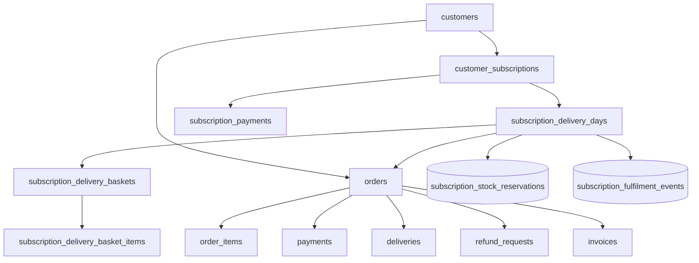

# Phase 2.3 — Demo / test / QA data audit (read-only)

**Generated:** 2026-11-03 (Asia/Kolkata)  
**Scope:** Codebase + connected database snapshot (`app.env=local`, schema `1.20.0-invoices`)  
**Method:** SELECT-only queries via `scripts/audit-demo-test-data-readonly.php` — **no deletes, updates, or DSN changes performed.**

Re-run audit (read-only):

```bash
php scripts/audit-demo-test-data-readonly.php > storage/audit-demo-test-data.json
```

---

## Executive summary

This installation is a **development/QA database**, not a clean production merchant dataset.

| Signal | Finding | Confidence |
|--------|---------|------------|
| Subscription scale | **5,671** `customer_subscriptions`, **12,460** delivery days, **1,452** subscription-sourced orders | **High** QA volume (Stage 11 / D5 / fulfilment CLI suites) |
| Subscription payments | **2,128** rows, **100% `gateway=simulate`** | **High** test checkout |
| Storefront orders | **70** rows (`order_source=storefront`); **21** with captured **simulate** payments | **Mixed** — some may be manual QA, not production |
| Known CLI markers | **14** `AT-C1FIX-*` orders, **28** `987C1*` mobiles, **14** `RF-C1*` refunds | **High** Stage 12 C1 fixtures (or incomplete teardown) |
| Catalogue | **9/10** products match **demo seed slugs** from `scripts/seed-catalogue.php` | **High** seed/demo catalogue |
| Testimonials | **487** rows, **all `pending`** | **High** QA / stage tests |
| Support tickets | **544** rows (**520** `open`) | **High** QA (`test-support-access.php`, notification tests) |
| Invoices | **4** documents (**3** retail) | **Low volume** — treat as **manual review** (may be invoice test runs) |

**Do not** treat “all `AT-*` orders” as test data: **`AT-{ymd}-{token}` is the normal storefront order number format** (`includes/commerce/checkout.php`). Only **documented prefix patterns** (below) are reliable test markers.

---

## 1. Classification criteria and confidence

| Class | Meaning | Evidence required |
|-------|---------|-------------------|
| **1 — Genuine business** | Real customer/commerce intended for go-live | Production gateway captures, merchant-entered catalogue, non-test audit narrative, or explicit business sign-off |
| **2 — Known test data** | Created by named CLI/QA scripts with documented prefixes | Order/sub/mobile/refund/slug patterns in fixture files; script teardown docs |
| **3 — Demo/seed data** | Copied from `DemoCatalogue` or install seed | `scripts/seed-catalogue.php`; demo product/category slugs |
| **4 — QA/debug-generated** | Bulk side effects of automated suites without unique prefix | High row counts + simulate gateway + local env; subscription/menu/basket explosion |
| **5 — Unknown — manual review** | Cannot classify from markers alone | e.g. storefront orders without simulate payment, single admin user, settings keys |

**Rule applied:** Names or dates alone are **not** used to classify test data (per Phase 2.3 requirements).

---

## 2. Database table-wise record counts

Snapshot from read-only audit (**89 tables**). Zeros omitted where unremarkable.

| Table | Count | Primary classification | Notes |
|-------|------:|------------------------|-------|
| **customers** | 54 | 4 / 5 | 28 match `987C1%` (C1 fixtures) |
| **customer_addresses** | 10 | 4 / 5 | Tied to customers |
| **customer_otp_attempts** | 13 | 4 | OTP test scripts |
| **orders** | 1,522 | 4 | 1,452 `order_source=subscription`; 70 storefront |
| **order_items** | 667 | 4 | FK → orders |
| **order_status_history** | 631 | 4 | FK → orders |
| **payments** | 42 | 4 | 27 `simulate`; 10 razorpay; 5 cashfree |
| **payment_webhook_events** | 2,977 | 4 | Webhook replay tests |
| **payment_refunds** | 5 | 2 / 5 | Some C1/C3 paths |
| **refund_requests** | 14 | 2 | 14 `RF-C1%` |
| **refund_request_* (child)** | 14–42 | 2 | FK → refund_requests |
| **deliveries** | 1,460 | 4 | Mostly subscription fulfilment tests |
| **delivery_status_history** | 5,679 | 4 | FK → deliveries |
| **delivery_slot_reservations** | 19 | 4 | D2/concurrency tests |
| **delivery_sms_logs** | 2,346 | 4 | D3 SMS tests |
| **delivery_sms_send_locks** | 3,859 | 4 | D3 hardening |
| **products** | 10 | 3 | 9 demo slugs + 1 `at-%` slug |
| **categories** | 9 | 3 | 4 demo category slugs |
| **product_variants** | 11 | 3 | Seed catalogue |
| **inventory_movements** | 2,019 | 4 | Admin adjust + checkout/subscription tests |
| **coupons** | 2 | 3 / 5 | 1× `WELCOME10` (common seed) |
| **coupon_usages** | 1 | 5 | |
| **offers** | 0 | — | |
| **customer_subscriptions** | 5,671 | 4 | 528 `payment_failed`; 576 `pending_payment`; simulate sub payments |
| **subscription_payments** | 2,128 | 4 | **All simulate** |
| **subscription_plans** | 6 | 3 / 2 | Plans 1–3 templates; 6–8 `ZT *755294` test |
| **subscription_menu_templates** | 1,581 | 4 | Menu planner / stage tests |
| **subscription_menu_template_items** | 1,580 | 4 | FK → templates |
| **subscription_delivery_days** | 12,460 | 4 | Core subscription QA graph |
| **subscription_delivery_baskets** | 1,617 | 4 | |
| **subscription_delivery_basket_items** | 1,616 | 4 | |
| **subscription_skips** | 528 | 4 | Lifecycle tests |
| **subscription_pauses** | 528 | 4 | Lifecycle tests |
| **subscription_fulfilment_events** | 684 | 4 | |
| **subscription_stock_reservations** | 684 | 4 | **Do not delete rows in isolation** |
| **subscription_basket_substitutions** | 870 | 4 | |
| **subscription_substitution_payments** | 865 | 4 | |
| **subscription_selection_audit** | 9,376 | 4 | Audit noise from tests |
| **subscription_notification_log** | 7,690 | 4 | |
| **customer_notifications** | 9,021 | 4 | |
| **subscription_auto_confirm_events** | 408 | 4 | |
| **invoices** | 4 | 5 | `scripts/test-invoices.php` |
| **invoice_sequences** | 2 | 5 | |
| **cms_pages** | 8 | 5 | May include legal placeholders |
| **faqs** | 0 | — | |
| **seo_redirects** | 1 | 5 | |
| **product_reviews** | 0 | — | |
| **testimonials** | 487 | 4 | All pending |
| **support_tickets** | 544 | 4 | QA tickets |
| **support_messages** | 592 | 4 | FK → tickets |
| **admin_users** | 1 | 5 | Real admin account (protect) |
| **admin_audit_logs** | 2,996 | 4 / 1 | Mixed admin + test actions |
| **admin_notifications** | 240 | 4 | Support notification tests |
| **settings** | 95 | 1 / 5 | Business config — **never bulk-delete** |
| **carts / cart_items** | 19 / 9 | 4 | Session/QA |

Full machine-readable counts: run `scripts/audit-demo-test-data-readonly.php`.

---

## 3. Evidence markers (high-confidence test/demo)

| Marker | Count (this DB) | Source |
|--------|----------------:|--------|
| `orders.order_number LIKE 'AT-C1FIX-%'` | 14 | `scripts/includes/stage12_phase_c1_fixture.php` |
| `customers.mobile LIKE '987C1%'` | 28 | C1 fixture |
| `refund_requests.request_number LIKE 'RF-C1%'` | 14 | C1 fixture |
| `orders.order_number LIKE 'AT-C3-%'` | 0 | `stage12_phase_c3_fixture.php` (clean) |
| `orders.order_number LIKE 'D2H-%'` | 0 | `d2h_test_fixture.php` |
| `customer_subscriptions.subscription_number LIKE 'SUB-H-%'` | 1 | `SubscriptionTestFulfilmentFixture` |
| `customer_subscriptions.subscription_number LIKE 'ZT-SUB-%'` | 1 | `test-subscription-admin-delete.php` |
| `products.slug` in demo seed set | 9 | `scripts/seed-catalogue.php` + `DemoCatalogue` |
| `payments.gateway = 'simulate'` | 27 | Payment test / local checkout |
| `subscription_payments.gateway = 'simulate'` | 2,128 | Subscription test checkout |
| `testimonials.customer_display_name LIKE 'AT-%'` | 0 | Stage 13 fixtures cleaned |
| `products.slug LIKE 'at-%'` | 1 | Stage 13/14 CLI slugs |
| `coupons.code = 'WELCOME10'` | 1 | Common seed coupon |

**Documented prefixes for future cleanup scoping** (from fixtures/scripts — not all present in DB):

- Orders: `AT-C1FIX-%`, `AT-C3-%`, `D2H-%`, `AT-PAY-%`, `AT-MAP-%`, `SUB-PG-%`
- Subscriptions: `SUB-H-%`, `ZT-SUB-%`, `SUB-PG-%`
- CMS/products/categories: slug prefixes `at-cms13-`, `at-faq13-`, `at-seo13-`, `at-sm13-`, `at-int13-`, `at-sd13-`, `at-rd13-`
- FAQs/questions: `AT-CMS13 %`, `AT-FAQ13-%`, `AT-INT13 %`, `AT-SD13 %`, `AT-HP8 %`
- Reviews: body `AT-C21-%`, display `AT-C21`
- Admin roles: `at-rbac14-custom`, `at-rbac14-custom-bad`
- Slot slug: `sub_fulfil_test` (`SubscriptionTestFulfilmentFixture`)

**Integration fixture (manual review):** `orders.order_number = 'AT-261102-5DB0C9'` referenced in `scripts/test-cart-order-post-payment.php` (customer id **80** in script).

---

## 4. Module-by-module assessment

### Customers and addresses
- **54 customers**; bulk tied to subscription QA. **28** C1 mobiles are **known test (2)**.
- Remaining customers: **unknown (5)** unless tied to simulate-only activity.

### Orders and order items
- **1,452** subscription fulfilment orders — **QA (4)**.
- **70** storefront orders — **mixed (5)**: **21** with captured simulate payment → likely **QA (4)**; remainder need manual review (could be real UAT).

### Payments and gateway transactions
- Order payments: simulate-heavy on local env.
- **All subscription payments simulate** → entire table effectively **QA (4)** for this DB.

### Subscriptions and subscription payments
- Dominant dataset (**5.6k+** subs). Status mix (`payment_failed`, `pending_payment`, `active`) matches automated Stage 11 / hardening / D5 runs.
- Plans **ZT Ref Plan 755294** etc. → **known test (2)**.

### Subscription deliveries, skips, pauses
- **12,460** delivery days, **528** skips/pauses — **QA (4)**.
- Graph must be deleted **child-first** (see dependency map).

### Invoices and credit notes
- **4** invoices — low volume; likely **`scripts/test-invoices.php`** — **manual review (5)** before any purge.

### Refunds
- **14** requests; all counted match **RF-C1** pattern — **known test (2)** with high confidence.

### Delivery slots and reservations
- **7** slots (config); **19** reservations — likely **QA (4)** from slot/concurrency tests.

### Products, categories, variants
- Almost entire catalogue matches **demo seed (3)**. Replacing with merchant catalogue is a **content migration**, not row deletion only.

### Inventory and stock reservations
- **2,019** movements — mixed admin + test checkout; do not delete without order/sub context.
- **684** `subscription_stock_reservations` — **never delete independently** of delivery day / fulfilment state.

### Coupons and offers
- **WELCOME10** — seed/demo candidate; second coupon requires manual review.

### Reviews and testimonials
- **0** reviews; **487** pending testimonials — **QA (4)** (stage 8/9 patterns).

### Menu planner templates
- **1,581** templates — **QA (4)** (subscription menu tests); plans 1–3 may be **business templates (5)**.

### Support tickets
- **544** tickets — **QA (4)** from support/notification test scripts.

### SEO and marketing configuration
- **1** redirect; **95** settings keys — **business/config (1/5)**. Do **not** include in automated data purge.

---

## 5. Dependency map (cleanup ordering)

Deleting data incorrectly will orphan rows or break FK constraints. **Never delete parent rows while children exist** (unless using documented CASCADE paths).



### Must not delete independently (examples)

| Entity | Depends on | Risk |
|--------|------------|------|
| `order_items`, `payments`, `deliveries`, `refund_requests`, `invoices` | `orders` | FK violations; finance audit loss |
| `subscription_payments` | `customer_subscriptions` | Payment reconciliation |
| `subscription_delivery_days` | `customer_subscriptions` | CASCADE to baskets/items/skips |
| `subscription_stock_reservations` | `subscription_delivery_days` | Inventory integrity |
| `payment_refunds` | `payments` / refund requests | Trust Stage 12 integrity |
| `admin_audit_logs` | — | **Append-only compliance trail** — archive, don’t delete without policy |
| `settings` | — | **Production configuration** |
| `invoice_sequences` | — | Legal numbering continuity |

### CASCADE notes (selected)
- `customer_subscriptions.customer_id` → `customers` **ON DELETE CASCADE** (dangerous: customer delete wipes subs).
- Many subscription child tables **CASCADE** from `customer_subscriptions` or `subscription_delivery_days` — prefer **scoped DELETE by test prefix** over customer-wide delete.

---

## 6. Codebase audit — scripts and demo surfaces

### Seed / demo (writes DB when run)

| Script / asset | Tables touched | Classification |
|----------------|----------------|----------------|
| `scripts/seed-catalogue.php` | `categories`, `products`, `variants`, images, attributes | **3** — skips if products already exist |
| `includes/demo/catalogue.php` | None (in-memory) | Demo fallback UI only |
| `DemoCatalogue` via `CatalogueGateway` | None when DB ready | Production blocked in Phase 2 |

### QA / test scripts (may INSERT/DELETE)

| Area | Example scripts | Typical tables |
|------|-----------------|----------------|
| Subscription | `test-subscription-stage11*.php`, `test-subscription-d5.php`, `test-subscription-admin-delete.php` | `customer_subscriptions`, `subscription_delivery_*`, `subscription_payments`, `orders`, `deliveries` |
| Delivery | `test-delivery-d*.php`, `test-delivery-slot-concurrency.php` | `orders`, `delivery_slot_reservations`, `deliveries`, SMS logs |
| Trust/refunds | `test-trust-stage12*.php`, fixtures `stage12_phase_c*.php` | `orders`, `payments`, `refund_requests`, `payment_refunds` |
| Stage 13 CMS/SEO/FAQ | `test-*-stage13*.php`, `scripts/includes/stage13_phase*_fixture.php` | `cms_pages`, `products`, `faqs`, `seo_redirects`, `testimonials` |
| Payments | `test-payment-stage9.php`, `test-payment-initiation.php`, `test-cart-order-post-payment.php` | `orders`, `payments`, `carts` |
| Invoices | `scripts/test-invoices.php` | `invoices`, `orders` |
| Support/SMS | `test-support-access.php`, `test-sms-stage14-phase3.php` | `support_tickets`, `support_messages`, `notification_queue` |
| Admin/RBAC | `test-rbac-stage14-phase1.php`, `stage14_phase1_fixture.php` | `admin_users`, `admin_roles` |
| Promotions | `test-promotions-stage10.php` | `coupons`, `offers` |

**Fixture teardown:** Many `scripts/includes/*_fixture.php` files implement **scoped DELETE** (prefix/LIKE). Tests that crash mid-run may leave markers (e.g. **14** C1 orders still present).

### Debug / test endpoints (code, not DB by default)

| Path | Purpose |
|------|---------|
| `ajax/payment/simulate.php` | Simulated payment completion — **disabled in production** (Phase 2) |
| `login.php` / OTP | Demo OTP `123456` when no DB — **not DB** |
| `scripts/test-cli-guard-probe.php` | CLI guard only |

### Hardcoded demo / fixture references (code)

- `admin/coupons/index.php` — demo row **only** when `AdminPersistence::allowsDemoPreview()` (not DB).
- `scripts/test-cart-order-post-payment.php` — hardcoded order `AT-261102-5DB0C9`, customer **80**.
- Order numbers `AT-{ymd}-{token}` — **production format**, not test marker.

---

## 7. Proposed cleanup strategy (Phase 3 — not executed)

1. **Freeze environment** — backup production separately; never run CLI tests against production.
2. **Tier A — known prefixes** — Delete in fixture-documented order (C1, C3, D2H, ZT-, SUB-H-, stage13 slugs). Reuse/teach from existing `*_teardown()` functions.
3. **Tier B — subscription QA bulk** — Option A: truncate subscription subgraph on **staging clone only**; Option B: delete subs where **all** payments are `simulate` AND created before cutover date AND no invoice link — **requires written SQL review**.
4. **Tier C — catalogue** — Replace seed catalogue via admin/import; do not DELETE products with live order line references.
5. **Tier D — support/testimonials/notifications** — Purge tickets/messages with QA subject patterns **only after** confirming no production customer emails.
6. **Tier E — retain** — `settings`, `admin_users`, `invoice_sequences`, legal CMS, real captured **non-simulate** payments, any order with invoice or GST audit.

**No cleanup SQL is included in this document by design.**

---

## 8. Backup and rollback requirements

Before any Phase 3 delete:

1. **Full logical backup** — `mysqldump --single-transaction` (all tables) + verify restore on isolated instance.
2. **Table-level exports** for finance: `orders`, `order_items`, `payments`, `payment_refunds`, `refund_requests`, `invoices`, `subscription_payments`, `customer_subscriptions`.
3. **Point-in-time** binary logs if production uses PITR.
4. **Rollback plan** — restore dump; re-run migrations if schema changed; never rely on DELETE without backup.
5. **Document cutover timestamp** and marker counts (re-run `audit-demo-test-data-readonly.php` before/after).

---

## 9. Records requiring manual approval

| Item | Why |
|------|-----|
| All **70** storefront orders | `AT-*` is normal numbering; 21 simulate-captured — classify each or keep for UAT |
| **Customer id 80** + order `AT-261102-5DB0C9` | Explicit integration fixture in tests |
| **3** default subscription plans (ids 1–3) | May be intended production templates |
| **4** invoices | Tax/legal implications |
| **95** `settings` rows | Business + gateway secrets |
| **1** admin user | Operations account |
| **8** CMS pages | Legal/copy |
| **Non-simulate payments** (razorpay/cashfree) | Possible real money test — **5** order payments |
| Second **coupon** (non-WELCOME10) | Promotion intent unknown |
| **1** product with non-demo slug (`at-%` only) | May be CLI-created test product |

---

## 10. Phase 3 readiness checklist

- [ ] Stakeholder sign-off on what “genuine” means for this merchant
- [ ] Production vs staging DSN isolation verified
- [ ] Backup restored and tested
- [ ] Cleanup SQL limited to **Tier A markers** first; measure with audit script
- [ ] Subscription bulk strategy approved by engineering + finance
- [ ] Catalogue strategy (re-seed vs admin edit) approved
- [ ] Post-cleanup: `StorefrontReadiness::productionBlockers()` empty on target env

---

## Appendix A — Read-only audit artifact

Regenerate JSON:

```bash
php scripts/audit-demo-test-data-readonly.php | tee storage/audit-demo-test-data-$(date +%Y%m%d).json
```

**This audit did not modify any database row.**
