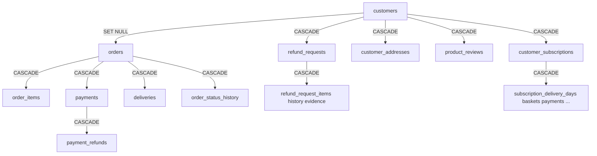

# Production test data cleanup — Phase 1 audit (read-only)

**Date:** 2026-11-08  
**Status:** Audit and planning only — **no DELETE/UPDATE/TRUNCATE was executed** in this task.  
**Protected customer:** Vijay Amule — mobile `9407005023`, email `vijayamule7@gmail.com`

---

## Executive summary

| Item | Action |
|------|--------|
| Production mutations | **None** — schema/code audit + read-only scripts only |
| Protected customer | Resolve `customers.id` on live DB via SQL section 1 (both mobile **and** email) |
| Safe test deletion candidates | **Tier A only** — rows tied to **documented fixture markers** (e.g. `AT-C1FIX-%`, `987C1%` mobiles) |
| Everything else | **REVIEW_REQUIRED** until human sign-off |
| Prior art | [PHASE3_CLEANUP_PLAN.md](./PHASE3_CLEANUP_PLAN.md), [PHASE3_1_EXECUTION_SAFETY_REVIEW.md](./PHASE3_1_EXECUTION_SAFETY_REVIEW.md), `storage/phase3-cleanup-manifest.json` |

**Run on production (read-only):**

```bash
php scripts/audit-production-test-data-phase1.php
# optional clone DSN:
CLONE_DB=your_prod_clone php scripts/audit-production-test-data-phase1.php

php scripts/phase3-1-tier-a-safety-review.php
php scripts/audit-demo-test-data-readonly.php

mysql ... your_db < scripts/sql/production-test-data-audit-readonly.sql
```

Output JSON: `storage/production-test-data-audit.json` (created when PHP audit runs against a connected DB).

> **This workspace DSN** did not run live production queries during this audit. Counts below for Tier A are from **prior local snapshots** in Phase 3 docs (Nov 2026), **not** your current production totals. Refresh using the commands above on **production or a clone**.

---

## 1. Protected customer (Vijay Amule)

### Identification rule (run on production)

Match **any** of:

- Normalized mobile digits = `9407005023` (strip `+91`, spaces, dashes)
- Email (case-insensitive trim) = `vijayamule7@gmail.com`
- Name = `Vijay Amule`

```sql
SELECT id, mobile, name, email, is_active, created_at
FROM customers
WHERE REPLACE(REPLACE(REPLACE(REPLACE(mobile,'+91',''),' ',''),'-',''),'\t','') = '9407005023'
   OR LOWER(TRIM(email)) = LOWER('vijayamule7@gmail.com')
   OR name = 'Vijay Amule';
```

### Classification

**PROTECTED_CUSTOMER** — do not include in any deletion `WHERE` clause.

### Evidence to retain (all related transactional data)

| Area | Tables (non-exhaustive) |
|------|-------------------------|
| Account | `customers`, `customer_addresses`, `customer_otp_attempts` (by mobile), `customer_notifications` |
| Commerce | `orders`, `order_items`, `order_status_history`, `order_cancellation_events`, `order_stock_restock_events` |
| Payments | `payments`, `payment_refunds`, `payment_completion_exceptions`, `payment_webhook_events` (if linked via merchant order id) |
| Refunds | `refund_requests`, `refund_request_*` |
| Invoices | `invoices` (+ PDF files on disk — separate backup) |
| Delivery | `deliveries`, `delivery_*`, `delivery_slot_reservations` |
| Subscriptions | `customer_subscriptions`, `subscription_*` subtree |
| Trust | `product_reviews`, `product_review_photos`, `review_moderation_history` |
| Support | `support_tickets`, `support_messages`, `support_message_attachments` |
| Marketing | `carts`, `cart_items`, `coupon_usages`, `customer_coupon_assignments`, `offer_customer_assignments` |
| Notifications | `notification_queue` (recipient / payload may reference orders) |
| Audit | `admin_audit_logs` only if order/customer refs appear in JSON — **do not bulk-delete admin audit** |

### Duplicate account check

`uq_customers_mobile` enforces one row per mobile string, but `9407005023` vs `+919407005023` could coexist if both were inserted. The audit SQL reports **overlap** sections — if **more than one** protected match: **STOP** and merge manually before any cleanup.

---

## 2. Customer classification rules

| Class | Meaning |
|-------|---------|
| **PROTECTED_CUSTOMER** | Vijay Amule match; any customer with live **razorpay/cashfree captured** payments you intend to keep; any customer with **invoices** you intend to keep |
| **SAFE_TEST_DATA** | Only when **explicit marker** + **zero blockers** (see Tier A) |
| **REVIEW_REQUIRED** | Linked to tests partially, mixed orders, unknown storefront history, or insufficient marker proof |

**Not used:** deleting customers because email “looks like test”, random names, or `@example.test` alone without fixture proof.

---

## 3. Tier A — candidate SAFE_TEST_DATA (marker-based)

Evidence sources: `scripts/includes/stage12_phase_c1_fixture.php`, `scripts/test-customer-account.php`, `scripts/test-account-list-pagination.php`, `SubscriptionTestFulfilmentFixture`, etc. Full list: [PHASE3_CLEANUP_PLAN.md §3](./PHASE3_CLEANUP_PLAN.md).

| Marker | Root entity | Classification | Typical fixture |
|--------|-------------|----------------|-----------------|
| `orders.order_number` `AT-C1FIX-%` | orders | SAFE_TEST_DATA | `stage12_phase_c1_fixture.php` |
| `refund_requests.request_number` `RF-C1%` | refund_requests | SAFE_TEST_DATA | C1 trust tests |
| `customer_subscriptions.subscription_number` `SUB-C1FIX-%` | subs | SAFE_TEST_DATA | C1 fixture |
| `customers.mobile` `987C1%` | customers | SAFE_TEST_DATA | C1 customers A/B |
| `SUB-PG-%` | customer_subscriptions | SAFE_TEST_DATA | pagination test |
| `SUB-H-%`, `ZT-SUB-%` | customer_subscriptions | SAFE_TEST_DATA | fulfilment / admin delete tests |
| `orders.order_number` `AT-ACCT%` | orders | SAFE_TEST_DATA | `test-customer-account.php` |
| `AT-C3-%`, `D2H-%`, `AT-PAY-%`, `AT-MAP-%`, `AT-R145-%` | orders | SAFE (if rows exist) | respective fixtures |

### Tier A blockers (must be **0** before auto-delete)

| Blocker | Query idea |
|---------|------------|
| Live gateway on C1 orders | `payments.gateway IN ('razorpay','cashfree')` on `AT-C1FIX-%` |
| Invoices on C1 orders | `invoices.order_id` → C1 orders |
| `987C1` customer with non-C1 order | orders not matching `AT-C1FIX-%` |
| Protected customer in candidate set | protected id ∩ `987C1%` |

### Tier B / REVIEW_REQUIRED (not auto-delete)

From Phase 3 docs — requires engineering + finance sign-off:

- Bulk `customer_subscriptions` without `SUB-*` markers (~thousands in dev snapshot)
- `payment_webhook_events`, `testimonials`, `support_tickets` bulk QA rows
- Storefront `AT-YYMMDD-*` / `VT-*` orders with **cashfree/razorpay** captures
- `orders.order_number` `TL-%` (timeline tests — **only** safe if **only** on disposable DB; on prod → **REVIEW_REQUIRED**)
- Orders `AT-TEST-%`, `VT-RETRY-%`, `VT-IDEM-%`, `AT-404%` if present on production

---

## 4. Tables proposed for transactional deletion (Tier A scope only)

Delete **rows**, never drop tables. **Child-first** manual order (CASCADE may help but do not rely on it blindly).

### Order subgraph (per marker-scoped `order_id`)

| Table | FK parent | ON DELETE (schema) |
|-------|-----------|---------------------|
| `delivery_email_logs` | orders | CASCADE |
| `delivery_sms_logs` | orders | CASCADE |
| `payment_completion_exceptions` | orders | CASCADE |
| `delivery_status_history` | deliveries | CASCADE |
| `delivery_slot_reservations` | orders | CASCADE / RESTRICT slot |
| `deliveries` | orders | CASCADE |
| `order_cancellation_events` | orders | CASCADE |
| `order_stock_restock_events` | orders | CASCADE |
| `order_status_history` | orders | CASCADE |
| `payment_refunds` | payments | CASCADE |
| `payments` | orders | CASCADE |
| `order_items` | orders | CASCADE |
| `invoices` | orders | **No FK in schema** — must DELETE explicitly if any |
| `refund_requests` | orders | CASCADE |
| `orders` | — | root |

### Refund subgraph

`refund_request_evidence`, `refund_request_items`, `refund_request_history` → `refund_requests` → `payment_refunds`

### Subscription subgraph

See `SubscriptionTestFulfilmentFixture::purgeTestSubscriptionsByNumberPrefix` and Phase 3 plan §3.3 (`subscription_delivery_days`, baskets, stock reservations, fulfilment orders, etc.).

### Customer row (last)

`customers` — only when no remaining FKs and **not** PROTECTED.  
**Note:** `ON DELETE CASCADE` from `customers` to many child tables — deleting one customer row can wipe subs/addresses/reviews. **Never** customer-wide DELETE without per-id verification.

---

## 5. Tables explicitly excluded (master / config)

Do **not** delete rows from:

- `products`, `product_variants`, `product_images`, `product_attributes`, `product_related`, `product_types`
- `categories`, `brands` (if present), `inventory_movements` (unless reversing specific test stock — separate process)
- `coupons`, `coupon_*` master, `offers`, `offer_*` master
- `subscription_plans`, `subscription_menu_*` templates/plans
- `delivery_zones`, `delivery_slots`, `delivery_store`
- `settings`, payment gateway credentials in `settings`
- `admin_users`, `admin_roles`, `admin_permissions`, `admin_*`
- `notification_templates`, `faq_*`, `cms_pages`, `seo_*`
- `invoice_sequences` (do not reset without finance approval)

Demo catalogue slugs (`fresh-red-tomatoes`, etc.) are **content**, not transactional cleanup — see Phase 3 Tier B.

---

## 6. Foreign key dependency map (customer-centric)



**Shared/master risk:** `order_items.variant_id` → `product_variants` — deleting orders does **not** delete variants.  
**RESTRICT:** `delivery_slot_reservations.delivery_slot_id` → `delivery_slots` (master slot rows stay).  
**Inventory:** `inventory_movements` may reference variants affected by test orders — review before stock cleanup.

Full FK listing: `scripts/sql/production-test-data-audit-readonly.sql` section 5 or `information_schema` export in `production-test-data-audit.json`.

---

## 7. Backup and recovery plan

1. **Pre-audit:** `mysqldump --single-transaction --routines --triggers DB > backup_pre_cleanup_YYYYMMDD.sql`
2. **Table-level exports** for Tier A tables (optional, faster restore):  
   `mysqldump DB orders payments ... --where="order_number LIKE 'AT-C1FIX-%'"`
3. **Invoice PDFs:** archive `storage/invoices/` (or configured path from `InvoiceService`)
4. **Rehearsal:** restore clone → run proposed deletes in transaction → `ROLLBACK` first, then commit on second pass
5. **Recovery:** stop app → restore dump or table extracts → verify protected customer order count → re-enable app

**Clone rehearsal:** [PHASE3_2_CLONE_REHEARSAL.md](./PHASE3_2_CLONE_REHEARSAL.md), `scripts/phase3-2-tier-a-clone-rehearsal.php`

---

## 8. Proposed deletion dependency order (do not execute yet)

1. `payment_refunds` (scoped)
2. `refund_request_*` → `refund_requests` (`RF-C1%` / order-scoped)
3. `delivery_email_logs`, `delivery_sms_logs`, `delivery_status_history`, `deliveries`, `delivery_slot_reservations`
4. `payment_completion_exceptions`, `payments`, `order_*`, `orders` (marker)
5. Subscription fulfilment children → `customer_subscriptions` (marker)
6. `subscription_payments`
7. Orphan check: customers with **only** test markers
8. `customers` (`987C1%` etc.) **excluding** all `PROTECTED_CUSTOMER` ids

Detailed commented SQL: `scripts/sql/production-test-data-deletion-PROPOSED.sql`  
PHP teardown reference: `stage12_phase_c1_teardown()` in `scripts/includes/stage12_phase_c1_fixture.php`

---

## 9. Verification checklist (post-approval, pre-production delete)

- [ ] Protected customer ID recorded; counts exported
- [ ] `phase3-1` blockers = 0 on **clone**
- [ ] Vijay’s orders/payments/invoices unchanged (re-count)
- [ ] No `razorpay`/`cashfree` captured rows in delete scopes
- [ ] `invoice_sequences` untouched
- [ ] Master table counts unchanged
- [ ] Rollback tested once per scope batch

---

## 10. Approval gate

**Stop here.** Reply with explicit approval listing:

- Approved Tier A scopes (by marker name)
- Approved customer IDs (if any customer-row deletes)
- Target environment (clone vs production)
- Maintenance window / cron paused

No deletion will be performed until you approve.
